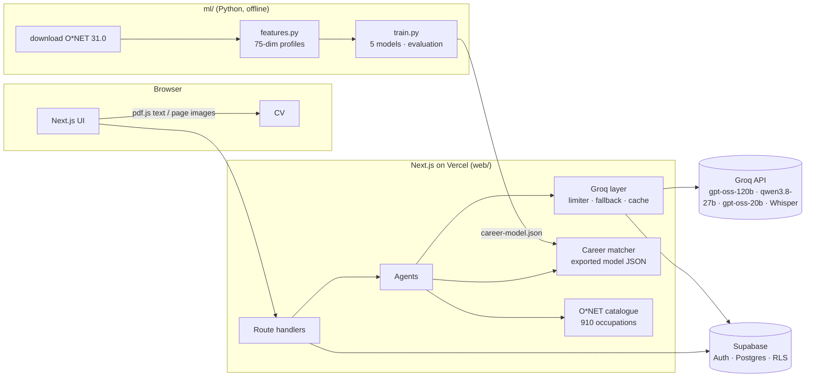

# CareerCompass — Career & Education Advisor

An AI agent that turns a student's interests and background into a **multi-step roadmap — courses → skills → career** — grounded in the **O\*NET 31.0** occupational database, with a supervised career-matching model and a set of Groq-powered agents around it.

> Supervised Learning project · B.Tech CSE (AI & ML), Lovely Professional University
> Brief: *"Build an agent that, given a student's interests/background, produces a multi-step roadmap (courses → skills → career) rather than a single generic answer. Deliverable: agent demo + 3 sample generated roadmaps. Dataset: O\*NET."*

## What it does

| | |
|---|---|
| **Onboarding** | Upload a CV (text PDFs parsed in the browser; scanned pages go through vision OCR) or fill it in. Education, academics, self-rated skills, projects, experience, a 12-item RIASEC interest quiz, goals and time budget. Contact details are stripped and never stored. |
| **Career matching (ML)** | A model trained on 910 O\*NET occupations scores the student's 75-feature profile → career-family probabilities (logistic regression) + ranked occupations (z-scored cosine similarity). |
| **Roadmap agent** | 7 steps, streamed live: Profile Analyst → Career Matcher → Navigator → Gap Analyzer → Curriculum Planner → Roadmap Composer → Critic. Output is an interactive graph of courses → skills → career, split into phases. |
| **Customisable roadmap** | Map + timeline views, tick off steps, reorder, add your own, change pace, **ask the agent in plain words** ("compress to 3 months"), or get **AI suggestions** grounded in your practice results. Previews before saving, full version history. |
| **Dashboard** | Explainable readiness score, next actions, career matches, Company Scout suggestions (LLM + skill-overlap fit), XP / level / streak, activity heatmap. |
| **Practice** | Academic subjects (DSA, OS, DBMS, CN, OOP, ML, maths) and placement sections (quant, logical, verbal, code output). Timed MCQs, instant server-side grading, explanations. Shared question bank grown by a Question Setter agent. |
| **Interviews** | Choose role, company, difficulty and type. Adaptive interviewer (follow-up / next / close), voice answers via Whisper, panel report with dimension scores and stronger-answer outlines. |
| **Mentor** | Streaming chat for career + academic questions. Plans which tools to use (O\*NET facts, career search, your matches, progress, roadmap) before answering. |
| **Samples** | `/samples` — three public roadmaps generated end-to-end by the live agent, each with its trace. |

## Architecture



### Supervised learning (`ml/`)

* **Data** — O\*NET 31.0: essential skills (10), transferable skills (25), knowledge (33) importance ratings, RIASEC interests (6) and job zone (1) → **75 features** for **910 occupations**, labelled with occupation and **career family** (SOC major group, 22 classes).
* **Training set** — O\*NET has one profile per occupation, so we simulate students: 100 noisy, partially observed copies per occupation (Gaussian noise σ ∈ [0.04, 0.22], 0–35 % features hidden and mean-imputed) → 91,000 samples.
* **Models compared** — Logistic Regression, k-NN, Random Forest, Linear SVM, MLP.
* **Evaluation** — stratified split, *unseen-occupation* group split (honest generalisation), robustness vs. noise, occupation top-k retrieval, temperature calibration.

| Model | Acc. (seen) | Macro-F1 (seen) | Acc. (unseen occ.) | Top-3 (unseen occ.) |
|---|---|---|---|---|
| Logistic Regression | 0.709 | 0.674 | **0.609** | **0.873** |
| k-NN | **0.906** | **0.898** | 0.580 | 0.826 |
| Random Forest | 0.783 | 0.751 | 0.606 | 0.867 |
| Linear SVM | 0.703 | 0.658 | 0.601 | 0.852 |
| MLP | 0.835 | 0.813 | 0.596 | 0.856 |

k-NN wins on seen occupations by memorising near-duplicates; **logistic regression generalises best** to occupations it never saw, so it is deployed for family probabilities. Exact-occupation ranking uses z-scored cosine similarity: **95.6 % top-5**. Full report: [`ml/reports/README.md`](ml/reports/README.md).

At inference the **Profile Analyst** (LLM) rates the student on the 68 skill/knowledge descriptors, the RIASEC quiz supplies interests and education supplies the job zone; a distribution-alignment step maps self-rated proficiency onto O\*NET's importance scale before scoring.

### Groq layer (free tier)

Free tier on this account: **1,000 requests/day and 8,000 tokens/minute per model**.
* **Model fallback** per task tier — reasoning: `gpt-oss-120b → qwen3.8-27b → gpt-oss-20b`; vision: `qwen3.8-27b`; speech: `whisper-large-v3-turbo → whisper-large-v3`.
* **Shared rate limiter** in Postgres (`cc_groq_reserve`): token-aware per-minute and per-day budgets across all serverless instances; 429s put a model on cooldown from Groq's `retry-after` / reset headers.
* **Cache** (`ai_cache`) for deterministic work: CV extraction, profile analysis, planner/composer outputs, company suggestions.
* **Per-user hourly quotas** that fail closed.

## Repository layout

```
.
├── web/                 Next.js 16 app (UI + API + agents) — deployed to Vercel
│   ├── src/app/         pages and route handlers
│   ├── src/components/  UI (design system, roadmap graph, interview room…)
│   ├── src/server/      server-only: ai/ (Groq), agents/, ml/ (inference), onet/, services/, db/
│   ├── src/lib/         shared types and pure logic
│   └── tests/           unit tests
├── ml/                  Python pipeline: download → features → train/evaluate → export
│   ├── src/  reports/  notebooks/
├── data/processed/      catalogue, alternate titles, feature metadata (raw O*NET is downloaded)
├── supabase/migrations/ database schema, RLS, limiter / cache / quota functions
└── docs/                design doc, roadmap, progress log, architecture
```

## Running locally

```bash
cd web
cp .env.example .env.local   # fill in Supabase + Groq keys
npm install
npm run dev
```

Database: `supabase link --project-ref <ref>` then `supabase db push`.
Retrain the model: `pip install -r ml/requirements.txt && python ml/src/download.py && python ml/src/features.py && python ml/src/train.py`.

Checks: `npm run lint && npm run typecheck && npm test && npm run build` (in `web/`).

## Deployment (Vercel)

Project settings → **Root Directory: `web`**. Environment variables: `NEXT_PUBLIC_SUPABASE_URL`, `NEXT_PUBLIC_SUPABASE_ANON_KEY`, `SUPABASE_SERVICE_ROLE_KEY`, `GROQ_API_KEY`. Supabase Auth → URL configuration must list the site URL and `/auth/callback`.

## Credits

Career data: **O\*NET 31.0 Database** by the U.S. Department of Labor, Employment and Training Administration (USDOL/ETA), used under the CC BY 4.0 license. O\*NET® is a trademark of USDOL/ETA. CareerCompass has modified the data and is not endorsed by USDOL/ETA.
