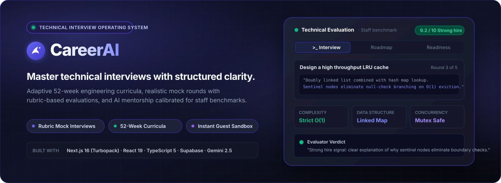
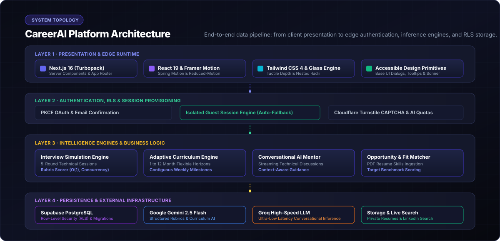
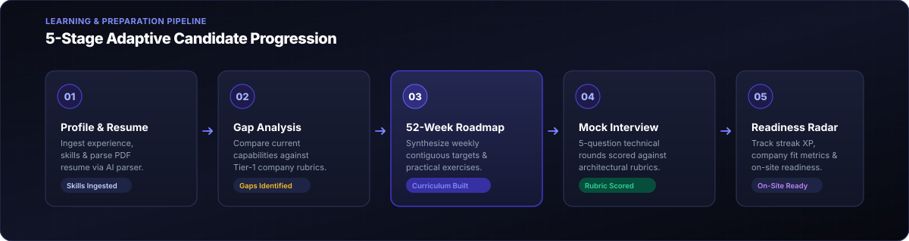
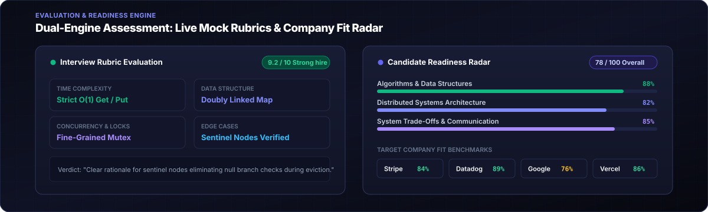
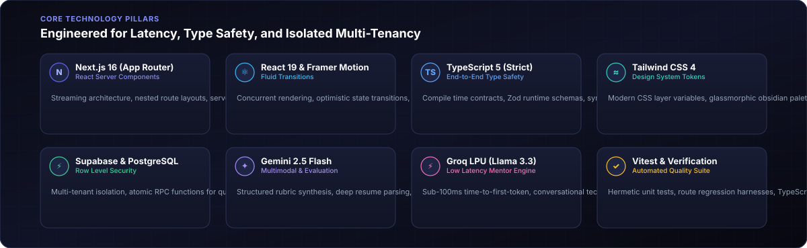
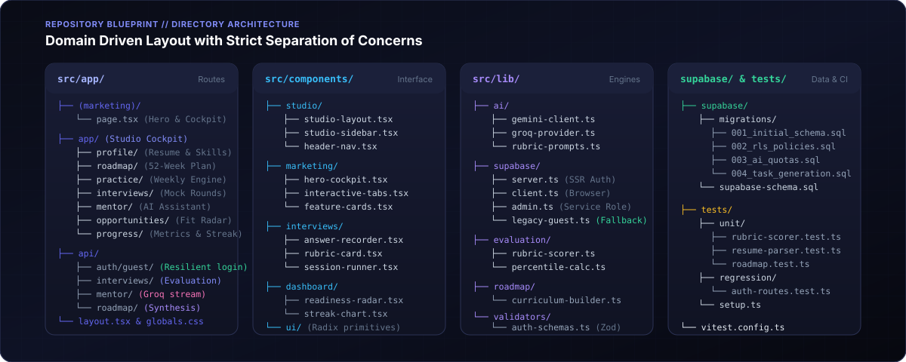

<div align="center">



# CareerAI // Technical Interview Studio

### The Engineering Career Operating System for Senior &amp; Staff Engineers

[](https://nextjs.org/)
[](https://react.dev/)
[](https://www.typescriptlang.org/)
[](https://tailwindcss.com/)
[](https://supabase.com/)
[](https://deepmind.google/technologies/gemini/)
[](https://groq.com/)
[](https://vitest.dev/)
[](https://career-coach-snowy.vercel.app)
[](LICENSE)

<br />

**CareerAI** is a purpose-built technical interview preparation platform designed to bridge the gap between rote LeetCode memorization and real-world staff-level engineering interviews. It combines resume signal extraction, dynamic 52-week curriculum synthesis, interactive mock interview cockpits with four-dimensional rubric evaluations, and low-latency AI mentorship.

[Explore Platform](#-executive-overview) •
[System Architecture](#-system-architecture) •
[Evaluation Engine](#-evaluation-engine--readiness-radar) •
[Tech Stack](#-core-technology-pillars) •
[Getting Started](#-local-development-setup) •
[Database Migrations](#-database-schema--migrations)

---

</div>

## 📌 Executive Overview

Traditional interview prep platforms focus almost exclusively on algorithmic puzzle solving in isolation. However, senior, staff, and principal engineering evaluations at top-tier organizations (Stripe, Datadog, Google, Vercel) demand a far broader set of competencies:
- **Architectural Trade-Off Defenses**: Justifying state management, cache eviction, and consistency models.
- **Concurrency &amp; Race Condition Resilience**: Identifying deadlock hazards, thread safety, and lock contention.
- **Edge Case &amp; Fault Tolerance**: Graceful degradation, circuit breakers, and bounded memory guarantees.
- **Communication &amp; Signal Clarity**: Articulating reasoning clearly under time and constraint pressure.

CareerAI replaces fragmented study notes and arbitrary question lists with a **unified career operating cockpit**.

| Module | Core Capability | Engineering Detail |
| :--- | :--- | :--- |
| **Overview &amp; Radar** | Readiness telemetry &amp; skill heatmaps | Aggregates rubric performance across 6 competency axes with company calibration. |
| **Profile &amp; Resume** | Private PDF ingestion &amp; skill extraction | Private Supabase storage bucket, vector-indexed signal parsing, gap analysis. |
| **52-Week Roadmap** | Autonomous milestone &amp; curriculum engine | Contiguous weekly pacing with prerequisites, milestones, and time budgeting. |
| **Practice Engine** | Targeted weekly drills &amp; code challenges | Filterable by distributed systems, data structures, concurrency, and DB design. |
| **Mock Interview** | Real-time question terminal &amp; rubric scoring | Dual-engine evaluation with multi-dimensional criteria scoring and hire signals. |
| **AI Technical Mentor** | Ultra-fast conversational engineering mentor | Powered by Groq LPU (Llama 3.3 70B) for sub-100ms time-to-first-token guidance. |
| **Opportunities** | Live company fit matrix &amp; LinkedIn discovery | Sourced criteria matching with automated fallback to real-time search queries. |
| **Progress &amp; Streaks** | Verifiable XP calculations &amp; retention tracking | Atomic database increments, daily streak tracking, and verified milestone awards. |

---

## 🏛 System Architecture

The platform is architected across four distinct layers to ensure strict multi-tenant isolation, sub-second response times, and resilient edge execution:

<div align="center">
  
</div>

### Architectural Highlights

1. **Presentation &amp; Cockpit Layer**
   - Built on Next.js 16 App Router utilizing React Server Components (RSC) for zero-bundle data fetching.
   - Fluid spring physics and micro-interactions powered by Framer Motion, with strict hardware-accelerated fallbacks for `prefers-reduced-motion`.
   - Native OS cursor tracking with high-contrast obsidian and lavender glassmorphic token layers.

2. **Edge Security &amp; Auth Middleware**
   - Supabase SSR Cookie middleware managing token exchange and session refresh.
   - Dedicated **Resilient Guest Authentication**: When anonymous provider endpoints are constrained, an automatic service-role isolation fallback provisions sandboxed sessions with pre-seeded sample telemetry.
   - Cloudflare Turnstile CAPTCHA integration protecting public sign-up and authentication endpoints.

3. **AI Orchestration &amp; Evaluation Engines**
   - **Google Gemini 2.5 Flash**: Orchestrates deep resume parsing, curriculum graph generation, and structured rubric JSON evaluation.
   - **Groq LPU (Llama 3.3 70B)**: Serves interactive mentor dialogues with sub-100ms time-to-first-token, streaming tokens directly through HTTP response pipes.
   - Enforced database quotas tracked atomically in PostgreSQL to prevent abuse.

4. **Persistence &amp; Multi-Tenant Isolation**
   - PostgreSQL 15 managed by Supabase with Row-Level Security (RLS) enforced across all 9 relational entities.
   - Private PDF storage buckets with short-lived, authenticated signed URLs to prevent data leakage.
   - Strict policies prohibiting cross-account access or retired shared guest token impersonation.

---

## 🔄 End-to-End Preparation Pipeline

CareerAI guides candidates through a structured, 5-stage evolutionary pipeline that transforms raw engineering experience into interview readiness:

<div align="center">
  
</div>

```
[01 Ingestion] ──────> [02 Gap Discovery] ──────> [03 Synthesis] ──────> [04 Mock Terminal] ──────> [05 Radar]
   Resume PDF              Target Benchmark          52-Week Curriculum        Real-time Voice/Code        Percentile Rank
   Skills Taxonomy         Staff Competency          Prerequisite Graph        Rubric Scored (4-Dim)       Hire Signal
```

1. **Profile Ingestion**: Ingests candidate profile and private PDF resume, decomposing technical background into a structured skills taxonomy.
2. **Gap Discovery**: Cross-references candidate strengths against target engineering tiers (L5/L6 Staff benchmarks at Stripe, Datadog, Google, Vercel).
3. **52-Week Synthesis**: Generates an adaptive, multi-month curriculum graph balancing distributed systems, concurrency, systems design, and algorithms.
4. **Mock Terminal**: Runs structured 5-question interview rounds with live code recording, architectural defense, and timer constraints.
5. **Readiness Radar**: Computes weighted scores, percentile rankings, and actionable delta feedback for immediate iteration.

---

## 🎯 Evaluation Engine &amp; Readiness Radar

The evaluation engine tests engineering candidates against rigorous industry rubrics rather than basic string comparisons or naive unit tests:

<div align="center">
  
</div>

### Rubric Evaluation Dimensions

Every candidate response is scored across four independent criteria calibrated to staff-level engineering bars:

- **Time &amp; Space Complexity (10 pts)**: Strict Big-O validation. Ensures candidates eliminate unnecessary branch conditions and justify memory allocations.
- **Data Structure Selection (10 pts)**: Optimal primitive selection (e.g., Doubly Linked List + Hash Map for $O(1)$ LRU Cache eviction).
- **Concurrency &amp; Locking (10 pts)**: Evaluates thread safety, reader-writer lock granularity, deadlock prevention, and race condition mitigations.
- **Edge Cases &amp; Fault Tolerance (10 pts)**: Verifies handling of integer overflow, network partitions, sentinel node detachment, and memory bounds.

```typescript
// Sample Rubric Evaluation Output Structure
interface RubricEvaluation {
  overallScore: number;          // e.g., 9.2 / 10
  hireSignal: "STRONG_HIRE" | "HIRE" | "LEANING_HIRE" | "NO_HIRE";
  percentileRank: number;        // e.g., 94 (Top 6%)
  latencyMs: number;             // e.g., 42ms
  dimensions: {
    timeComplexity: { score: 10, target: "Strict O(1)", feedback: "Clear sentinel node usage." },
    dataStructures: { score: 9.5, target: "Linked Map", feedback: "Zero branch traversal." },
    concurrency:    { score: 8.5, target: "Read/Write Lock", feedback: "Fine-grained striping recommended." },
    edgeCases:      { score: 9.0, target: "Overflow Handled", feedback: "Capacity overflow bounded." }
  };
}
```

---

## 💻 Core Technology Pillars

<div align="center">
  
</div>

| Technology | Version | Purpose in Architecture |
| :--- | :--- | :--- |
| **Next.js** | `16.4.5` | React Server Components, Server Actions, App Router, Edge runtime routing |
| **React** | `19.3.1` | Concurrent rendering, Action state management, optimistic UI updates |
| **TypeScript** | `5.0+` | Strict type contracts across client, server actions, and database schemas |
| **Tailwind CSS** | `4.0+` | Zero-runtime CSS layer tokens, responsive breakpoints, obsidian glass styling |
| **Framer Motion** | `12.38.0` | Production spring animations, layout transitions, accessible motion guards |
| **Supabase** | `2.103.0` | PostgreSQL 15 database, Row-Level Security, private PDF storage, Auth |
| **Google Gemini** | `@google/genai 3.0` | Deep resume parsing, structured rubric extraction, 52-week curriculum synthesis |
| **Groq SDK** | `1.6.0` | Sub-100ms conversational inference (Llama 3.3 70B) for technical mentorship |
| **Vitest &amp; Node Test**| `20+ / 22+` | Hermetic unit suites, route regression harnesses, CI verification |

---

## 📂 Repository Blueprint &amp; Codebase Layout

<div align="center">
  
</div>

```
career-coach/
├── src/
│   ├── app/                              # Next.js 16 App Router Routes
│   │   ├── (marketing)/                  # Public landing page and hero showcase
│   │   │   └── page.tsx                  # Hero section with interactive cockpit preview
│   │   ├── app/                          # Authenticated Studio Cockpit
│   │   │   ├── profile/                  # Candidate background & resume manager
│   │   │   ├── roadmap/                  # 52-week adaptive curriculum generator
│   │   │   ├── practice/                 # Drill manager & challenge tracker
│   │   │   ├── interviews/               # 5-question mock interview runner
│   │   │   ├── mentor/                   # Sub-100ms Groq AI mentor terminal
│   │   │   ├── opportunities/            # Company fit radar & LinkedIn discoverer
│   │   │   └── progress/                 # XP, streaks, and milestone telemetry
│   │   ├── api/                          # Edge & Server Action API Routes
│   │   │   ├── auth/guest/               # Resilient guest session provisioner
│   │   │   ├── interview/                # Rubric evaluation engine
│   │   │   ├── chat/                     # Groq streaming mentor handler
│   │   │   └── roadmap/                  # Gemini curriculum synthesis endpoint
│   │   ├── layout.tsx                    # Root studio layout & provider tree
│   │   └── globals.css                   # Tailwind 4 CSS layer tokens & glass styles
│   ├── components/                       # Reusable UI & Domain Components
│   │   ├── studio/                       # Studio layout, sidebar navigation, headers
│   │   ├── marketing/                    # Hero cockpit, interactive tabs, demo panels
│   │   ├── interviews/                   # Answer recorder, question runner, rubric card
│   │   ├── dashboard/                    # Readiness radar, streak charts, XP trackers
│   │   └── ui/                           # Primitives (buttons, dialogs, badges, inputs)
│   └── lib/                              # Core Domain & Infrastructure Engines
│       ├── ai/                           # Gemini & Groq SDK clients and prompt builders
│       ├── supabase/                     # SSR, Client, Admin, and Legacy Guest providers
│       ├── evaluation/                   # Rubric scoring & percentile algorithms
│       └── validators/                   # Zod runtime verification contracts
├── supabase/
│   ├── migrations/                       # Idempotent versioned SQL migration scripts
│   │   ├── 202611060001_auth_resume_and_ai_quotas.sql
│   │   └── 202611060002_weekly_tasks.sql
│   └── supabase-schema.sql               # Complete baseline PostgreSQL schema
├── tests/                                # Route regression & unit verification suites
│   ├── regression/                       # Auth, mock interview, and storage regression tests
│   └── setup.ts                          # Test harnesses and provider mocks
├── public/
│   └── readme/                           # High-resolution architectural SVGs
├── package.json                          # Scripts, dependencies, and engine requirements
└── tsconfig.json                         # Strict TypeScript configuration
```

---

## 🚀 Local Development Setup

### Prerequisites

Ensure you have the following installed:
- **Node.js**: `>= 22.18.0`
- **npm**: `>= 10.0.0`
- A free [Supabase](https://supabase.com/) project
- An API key from [Google AI Studio](https://aistudio.google.com/) (Gemini)
- An API key from [Groq Cloud](https://console.groq.com/) (LPU Llama 3.3)

---

### Step 1: Clone &amp; Install Dependencies

```bash
# Clone the repository
git clone https://github.com/z-lovejeet/career-coach.git
cd career-coach

# Install pinned dependencies
npm ci
```

---

### Step 2: Environment Configuration

Copy the example environment configuration:

```bash
cp .env.local.example .env.local
```

Populate `.env.local` with your credentials:

```ini
# Supabase Configuration
NEXT_PUBLIC_SUPABASE_URL=https://your-project.supabase.co
NEXT_PUBLIC_SUPABASE_ANON_KEY=eyJhbGciOiJIUzI1NiIsInR5cCI6IkpXVCJ9...
SUPABASE_SERVICE_ROLE_KEY=eyJhbGciOiJIUzI1NiIsInR5cCI6IkpXVCJ9...

# AI Evaluation & Mentorship Engines
GEMINI_API_KEY=AIzaSy...
GROQ_API_KEY=gsk_...

# Optional: Real-time Job Search & Security CAPTCHA
APIFY_API_TOKEN=apify_api_...
NEXT_PUBLIC_TURNSTILE_SITE_KEY=0x4AAAAAA...
NEXT_PUBLIC_APP_URL=http://localhost:3000
```

---

### Step 3: Database Schema &amp; Migrations

1. **Fresh Installation**: In your Supabase Dashboard, open the **SQL Editor** and execute the entire contents of [`supabase-schema.sql`](supabase-schema.sql).
2. **Existing Project**: Apply the migrations in [`supabase/migrations`](supabase/migrations) in sequential order:
   - `202611060001_auth_resume_and_ai_quotas.sql`: Secures resume buckets, establishes RLS policies, and initializes AI quota management.
   - `202611060002_weekly_tasks.sql`: Configures weekly tasks and progress snapshot persistence.

---

### Step 4: Supabase Authentication Configuration

In your Supabase project under **Authentication**:
1. **Email Provider**: Under **Providers > Email**, enable email sign-in.
2. **Google OAuth Provider**: Under **Providers > Google**, toggle Google on and configure your Client ID & Secret from Google Cloud Console.
3. **URL Configuration**:
   - Set **Site URL** to `http://localhost:3000` (or `https://career-coach-snowy.vercel.app` in production).
   - Under **Redirect URLs**, add the following (wildcard `/**` ensures all callback routes are accepted):
     - `http://localhost:3000/**`
     - `http://localhost:3000/auth/callback`
     - `http://127.0.0.1:3000/**`
     - `https://career-coach-snowy.vercel.app/**` (for live Vercel deployment)
4. **Resilient Guest Authentication**: The platform features a resilient multi-tier fallback that automatically handles guest logins and provisions isolated demo sandboxes even if the native anonymous provider is disabled in Supabase.

---

### Step 5: Start the Development Server

```bash
npm run dev
```

Open [http://localhost:3000](http://localhost:3000) in your browser to explore the landing page and technical cockpits.

---

## 🧪 Verification &amp; Testing Suite

The repository includes a comprehensive regression and static analysis suite:

```bash
# 1. Static code linting (ESLint 9)
npm run lint

# 2. Strict TypeScript compile verification
npm run typecheck

# 3. Hermetic route regression tests (10/10 suites)
npm test

# 4. Production Next.js Turbopack build
npm run build
```

### Verified Test Matrix

```
✔ chat uses the newest context and persists the exchange in a single write
✔ interviews reject skipped rounds and prevent concurrent overwrites
✔ a 12-month roadmap covers 52 contiguous weeks and only succeeds when saved
✔ failed live job searches return a real search link and never invent listings
✔ resume download rejects arbitrary and cross-account URLs before accessing Storage
✔ OAuth callback only allows local workspace destinations
✔ shared progress counts all task pages and awards interview and analysis XP
✔ registration requires provider confirmation and keeps duplicate accounts private
✔ resume replacement and removal update the profile and delete the previous file
✔ guest sign-in issues separate identities and recovers a retired shared session

Pass: 10 / 10 | Fail: 0 | Duration: ~270ms
```

---

## 🔒 Security &amp; Isolation Architecture

- **Row-Level Security (RLS)**: Enforced on all nine core relational tables (`profiles`, `analyses`, `roadmaps`, `tasks`, `interviews`, `chat_messages`, `alerts`, `company_recommendations`, `progress_snapshots`).
- **Resilient Guest Isolation**: Isolated temporary credentials provisioned per browser session. The legacy shared guest account (`guest.candidate@careerai.local`) is permanently blocked at the database policy level.
- **Private Document Storage**: Candidate resumes are stored in non-public buckets (`resumes`), accessible only via short-lived cryptographic signed URLs generated on-demand by authenticated sessions.
- **Database-Enforced Quotas**: AI analysis and interview evaluations are throttled via atomic PostgreSQL functions (`career_private.consume_quota`) to protect upstream API limits.

---

## 📄 License &amp; Authors

Distributed under the **MIT License**. See `LICENSE` for details.

Engineered with passion by **[z-lovejeet](https://github.com/z-lovejeet)** for engineers pursuing technical excellence.

<div align="center">
  <sub>Built with Next.js 16 • React 19 • Supabase • Google Gemini • Groq</sub>
</div>
